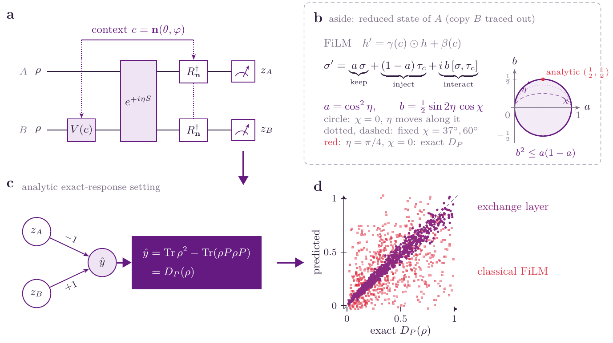
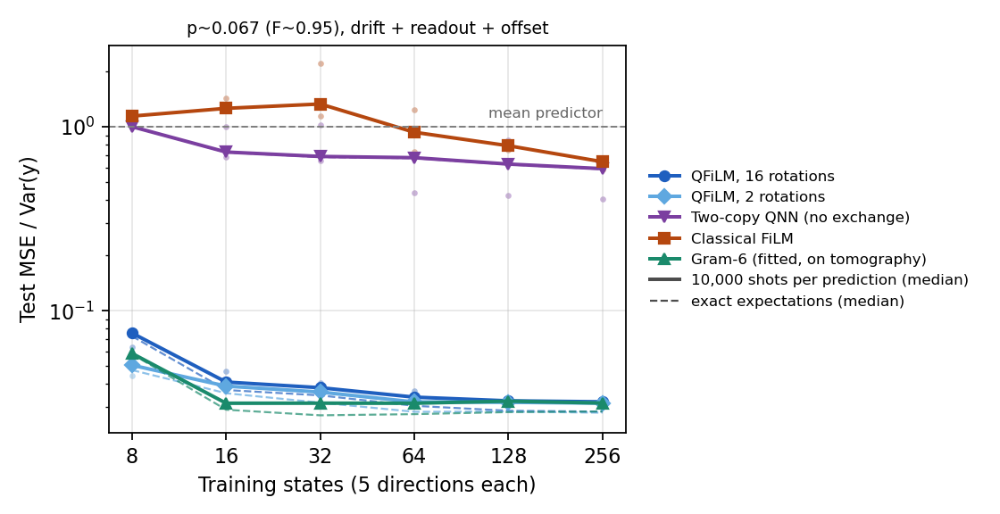
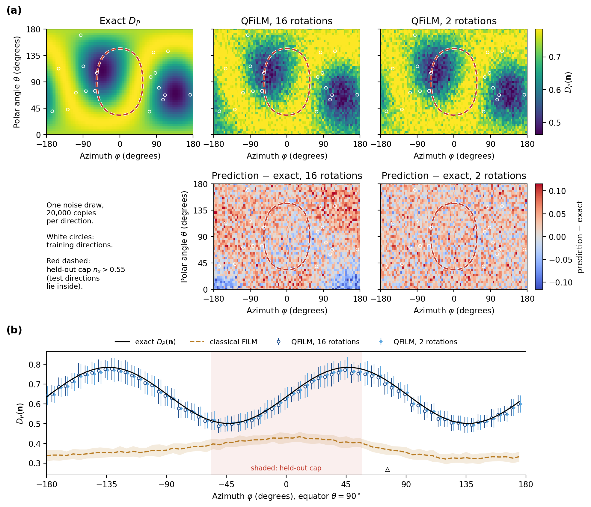
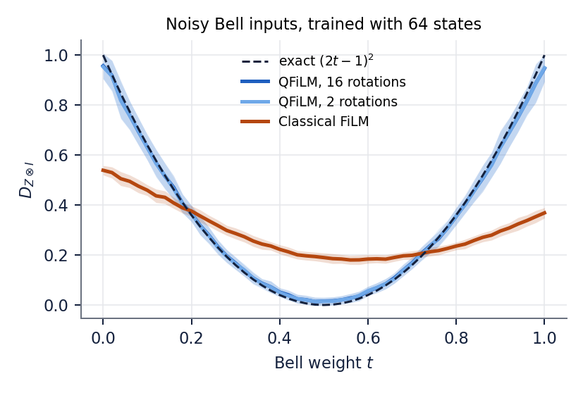

# Context-controlled exchange modulation

**A physics-first PyTorch + PennyLane project for repeatedly preparable quantum states.** It predicts how strongly a two-spin state responds to dephasing along a chosen direction, from two copies of the state under realistic preparation and measurement noise. The direction (the classical context) sets a source rotation on one copy; one partial exchange, with parameters trained and shared across directions, mixes the two copies, and a linear head combines the two measured ports into the prediction.



*Circuit, FiLM analogy, analytic exact-response setting, and predicted vs. exact response.*

## What the evidence supports

**Error vs. training size**



**Dephasing response over all directions** (a: 2D maps over θ and φ, and prediction minus exact; b: slice along the equator θ = 90°, φ from −180° to 180°)



| | Error vs. training size | Dephasing response |
|---|---|---|
| Noise (train and test) | drift p ≈ 0.067 (sd 0.03) + Pauli noise σ = 0.025 + offset 0.012 | same |
| Label | intended (noise-free) state | same |
| Training states | 8, 16, 32, 64, 128, 256 | 64 |
| Test data | 800 pairs: 200 new states × 4 held-out directions | 1 typical new state. (a) 45 θ × 90 φ directions (4° steps); (b) θ = 90° fixed, 72 φ values (5° steps) |
| Models | QFiLM 16 and 2 rotations, two-copy QNN (no exchange), classical FiLM, Gram-6 (fitted) | QFiLM 16 and 2 rotations; classical FiLM for reference |
| Seeds per model | 3 | QFiLM: 5. Classical FiLM: 1 model, selected on validation from 3 seeds |
| Shots per prediction | 10,000 (solid); exact expectations (dashed). FiLM and Gram-6: same copies via 9-basis tomography | QFiLM: 10,000. Classical FiLM: exact Pauli values of ρ̂ (no tomography shots) |
| Plotted value and error bar | median over seeds of test MSE / Var(y), each test pair predicted once with its own noise; small dots are single seeds | (b): mean over seeds of each model's mean over 30 noise redraws per direction (the mean response, not one prediction); bar: s.d. over the redraws within a model, pooled over seeds |
| Single-prediction error | the plotted value itself | (a): one draw over the whole map, MSE / Var = 0.30 (16 rotations) and 0.23 (2 rotations); (b): within-model s.d. 0.047 (averaged over directions), against 0.012 to 0.013 rms deviation of the averaged curve from the exact one |

**Bell mixing weight** (Bell family ρ_t = t Φ⁺ + (1 − t) Φ⁻: both marginals are maximally mixed and the intended label is D_{Z⊗I} = (2t − 1)²)



Models trained under realistic noise with 64 states; none saw a Bell state in training. Each Bell state gets the training noise: fresh preparation drift (p ~ N(0.067, 0.03)), Pauli-estimate noise (σ = 0.025, offset 0.012) and 20,000 copies of readout per prediction, redrawn 30 times. Lines are the mean over 3 seeds of each model's mean over the draws; bands are ±1 s.d. over the draws.

| Bell test, 64 states | Mean curve, MSE | One prediction, MSE (relative to Var = 0.096) |
|---|---|---|
| QFiLM, 16 rotations | 2.4e-4 | 1.8e-3 (0.019) |
| QFiLM, 2 rotations | 2.5e-4 | 1.7e-3 (0.018) |
| Classical FiLM | 0.057 | 0.072 (0.75) |

QFiLM follows (2t − 1)²; classical FiLM misses it. The fitted response (scale about 1.10, offset 0.011) approximately compensates for average input-noise effects. Applied to clean Bell inputs, this correction produces about 10% overshoot at the endpoints, illustrating sensitivity to a change in noise conditions. The paper's Fig. 9 shows the same test with the 400-state models.

**Comparison with a generic two-copy QNN.** The two-copy QNN gets the same two copies, context frame, readout and head as QFiLM, but a generic circuit (CNOT layers, 31 parameters) instead of the partial exchange. Both start from comparable random parameters.

| Test MSE / Var(y), 10,000 shots | 8 states | 64 states | 256 states |
|---|---|---|---|
| QFiLM, 16 rotations (median of 3 seeds) | 0.076 | 0.034 | 0.032 |
| QFiLM, 2 rotations (median of 3 seeds) | 0.051 | 0.032 | 0.031 |
| Two-copy QNN, no exchange (seeds 17, 31, 73) | 0.99, 1.00, 1.18 | 0.68, 0.97, 0.44 | 0.67, 0.59, 0.40 |
| Classical FiLM (median of 3 seeds) | 1.14 | 0.94 | 0.65 |
| Gram-6, fitted on tomography | 0.059 | 0.031 | 0.032 |

The median QNN error is 13, 20 and 18.5 times the median QFiLM-16 error at 8, 64 and 256 states. Its exact and 10,000-shot errors are nearly equal, so shot noise is not the cause: this generic circuit did not learn the response. The QNN differs from QFiLM in more than the exchange (no context-controlled source rotation, different gates, more parameters), so this compares two trained architectures rather than isolating the exchange. Tested with 3 seeds and up to 256 states.

## Start here

Install (Python 3.12; versions pinned in `requirements.txt`: Torch 2.14.1, PennyLane 0.45.1, NumPy, SciPy, Matplotlib; CPU only):

```bash
python3.12 -m venv .venv && source .venv/bin/activate
python -m pip install --upgrade pip
python -m pip install torch==2.14.1 --index-url https://download.pytorch.org/whl/cpu   # Linux; on macOS skip this line
python -m pip install -r requirements.txt
python -m pip install -e . --no-deps
```

The main training workflow uses `scripts/noise_study.py` (finished seeds are skipped, so its commands can be rerun); additional scripts generate the evaluation figures. Times are for a laptop CPU.

**1. Noise-study table** (all 8 noise settings, 64 training states, about 45 min)

```bash
python scripts/noise_study.py data   --train-states 64
python scripts/noise_study.py train  --train-states 64 --jobs 4
python scripts/noise_study.py report --train-states 64
```

Output: `results/noise_study/n64/table_noise.{md,tex}`, `numbers.json` and `fig_bell.{pdf,png}` (see `report` below).

**2. Error vs. training size** (realistic noise, 8 to 256 training states, about 1 h)

```bash
python scripts/noise_study.py all --train-states 8,16,32,64,128,256 \
  --scenarios F0.95sd_clean_r0.025_off0.012 --models qfilm16,qfilm2,qnn,film --jobs 4
```

Output: `results/noise_study/learning_curve_F0.95sd_clean_r0.025_off0.012.{pdf,png,json}`.

**3. Dephasing response over all directions** (realistic noise, 64 training states, about 20 min)

```bash
python scripts/noise_study.py rotations --train-states 64 --scenarios F0.95sd_clean_r0.025_off0.012 \
  --rotations 2,16 --seeds 17,31,73,101,137 --jobs 5
python scripts/noisy_direction_map.py --train-states 64
python scripts/noisy_bell.py --train-states 64
```

Output: `results/figures/noisy_direction_map_n64.{pdf,png}`, `results/noisy_direction_map/n64/summary.json`, and the Bell figure `results/figures/noisy_bell_n64.{pdf,png,json}`. Step 3 needs the 64-state data from step 1 or 2.

| Step | What it does |
|---|---|
| `data` | Draws states, applies the noise below, stores exact labels `D_P`; validation and test sets are fixed. |
| `train` | Trains the models below (seeds 17, 31, 73). |
| `report` | Test MSE / Var(y) for every model, plus fitted Gram-6 and the plug-in formula; a quick Bell check on noise-free Bell inputs (the noisy Bell test is `noisy_bell.py`). |
| `curve` (run by `all` with several sizes) | Test MSE against training size, exact and at `--copies` (default 20,000 = 10,000 shots). |
| `rotations` | QFiLM with k rotations in W, per seed. |

**Models** (`--models`, default `qfilm16,qfilm2,film`):

| Name | Model | Rotation block W | Trainable parameters |
|---|---|---|---|
| `qfilm16` | QFiLM, the paper's model | 16 Pauli rotations `exp(-i w Q/2)`: YI, ZI, IY, IZ, XX, ZZ, XI, IX, applied twice | 25 = 16 (W) + 4 (context frame) + 2 (exchange η, χ) + 3 (head) |
| `qfilm2` | QFiLM, small block | 2 rotations: YI, ZI | 11 = 2 + 4 + 2 + 3 |
| `qfilm1` | QFiLM, smallest block (optional) | 1 rotation: ZI | 10 = 1 + 4 + 2 + 3 |
| `qnn` | two-copy QNN, control without the exchange (optional) | 3 layers of Y, Z rotations on all 4 qubits with CNOT entanglers | 31 = 4 (frame) + 24 + 3 (head) |
| `film` | classical FiLM on the 15 Pauli values | none | width and L2 chosen on validation |

All QFiLM models also use a context frame `F(c) = R_Z(a_phi) R_Y(a_theta)` on qubit B1 (2 angles from the direction, through 4 trainable coefficients) and a fixed readout rotation `R_Y(-theta) R_Z(-phi)` that turns the direction onto z. Each training state is paired with 5 directions `(theta, phi)`, so 64 states give 320 training examples. In the report step, Gram-6 is fitted by least squares to the training labels (no iterative training), and the plug-in formula is evaluated on the noisy input without any training data.

**Which noise is included.** Each scenario combines up to three ingredients, applied when the data are generated:

1. preparation noise: `rho -> (1-p) rho + p I/4` (global depolarizing), with fixed `p` or a new `p` per state (drift, spread `sd(p)`);
2. Pauli-estimate noise: Gaussian error `σ` on each of the 15 Pauli values, plus a second Gaussian term `offset` (both drawn per state-direction pair), after which the nearest valid state is the model input;
3. the label: `intended` is the response of the noise-free state one meant to make (denoising, as in Morgillo et al.); `prepared` is the response of the state actually made, before Pauli-estimate noise (the physical answer for the qubits in hand).

The paper uses `intended` labels; prepared-label versions are run with `--custom` (below). For each pair the model inputs are identical, only the label differs.

Training and the noise-study table use exact expectation values; finite shots are added at prediction time in the result figures. Gates are ideal everywhere; detector bit flips appear only in `scripts/paper_qip_readout_flip.py` (paper Fig. 8).

**Noise settings** (Table 4 of the paper; `F` is the fidelity of a pure input, `1 - 3p/4`):

| Scenario | p | drift sd(p) | Pauli noise σ | offset | label |
|---|---|---|---|---|---|
| `F0.95_prepared` / `F0.95_clean` | 0.067 | 0 | 0 | 0 | prepared / intended |
| `F0.50_prepared` / `F0.50_clean` | 0.667 | 0 | 0 | 0 | prepared / intended |
| `F0.95sd_clean` | 0.067 | 0.03 | 0 | 0 | intended |
| `F0.50sd_clean` | 0.667 | 0.1 | 0 | 0 | intended |
| `F0.95_clean_r0.025` | 0.067 | 0 | 0.025 | 0 | intended |
| `F0.95sd_clean_r0.025_off0.012` | 0.067 | 0.03 | 0.025 | 0.012 | intended |

**Useful options:**

- `--train-states 400` uses the paper's training size. Data come from the same generator and seed as `scripts/paper_qip_data.py`, so a 64-state dataset is the first 64 training states of the 400-state one, with the same validation and test sets.
- `--scenarios F0.95_clean,F0.95sd_clean_r0.025_off0.012` runs a subset; `--models qfilm16,film` a subset of models; `--seeds 17` one seed for a quick check.
- `--seeds` with extra seeds trains only the new ones for QFiLM and the QNN. Classical FiLM selects width and L2 jointly over its seeds, so its seed list cannot be extended (delete its folder to retrain).
- `--custom "mine:p=0.1,p_sd=0.02,sigma=0.03,offset=0.01,target=clean"` adds your own noise condition (pass it to all three steps).

Prepared-label versions of the drift and realistic rows, next to their intended-label partners:

```bash
python scripts/noise_study.py all --train-states 64 --jobs 4 \
  --scenarios F0.95sd_clean,F0.95sd_clean_r0.025_off0.012 \
  --custom "drift_prep:p=0.0666667,p_sd=0.03,target=prepared" \
  --custom "realistic_prep:p=0.0666667,p_sd=0.03,sigma=0.025,offset=0.012,target=prepared"
```

Result of that command (test MSE / Var(y), 800 held-out pairs, mean of 3 seeds, 64 training states; run with `--models qfilm16,qfilm2,film`):

| Noise | Label | QFiLM 16 | QFiLM 2 | Classical FiLM | Gram-6 (fit) | Plug-in |
|---|---|---|---|---|---|---|
| drift | intended | 0.022 | 0.020 | 0.98 | 0.019 | 0.078 |
| drift | prepared | 1.2e-07 | 3.2e-11 | 0.87 | <1e-26 | <1e-26 |
| drift + readout + offset | intended | 0.031 | 0.028 | 0.97 | 0.027 | 0.082 |
| drift + readout + offset | prepared | 0.013 | 0.012 | 0.93 | 0.012 | 0.012 |

With the prepared label, drift costs nothing, and with readout noise QFiLM 2 matches the error of the exact formula applied to the noisy input (plug-in; 0.0116 for both, QFiLM 16 0.0126). That value is a reference level, not a proven lower bound. With intended labels, residual error reflects preparation drift, Pauli-estimate noise, and model fitting error.

The noise model is in `qem/noise_injection.py`, data generation in `qem/scaled_data.py`; training uses `scripts/train_torch.py` and `scripts/train_torch_classical.py`.

## Reproduce the paper

In the paper, all training data and all test inputs are noisy, including the Bell family of Fig. 9. The manuscript source is not part of this repository; the scripts below write the paper's figures and tables to `paper/qip/`. Run the commands of "Start here" first (blocks 2 and 3; block 1 is not needed for the paper), then:

```bash
# 400-state noise study; the longest step
python scripts/noise_study.py all --train-states 400 --models qfilm16,film --jobs 4
# rotation-block study (k = 1, 2, 8, 12, 16, 20 seeds each, about 1.5 h)
python scripts/noise_study.py rotations --train-states 64 --scenarios F0.95sd_clean_r0.025_off0.012 \
  --rotations 1,2,8,12,16 --seeds 17,31,73,101,137,211,223,227,229,233,239,241,251,257,263,269,271,277,281,283 --jobs 6
# figures and tables
python scripts/paper_qip_finite_shot.py
python scripts/paper_qip_readout_flip.py
python scripts/paper_qip_overview_panel.py
python scripts/noisy_bell.py --paper
python scripts/paper_qip_figures.py
```

| In the paper | Made by | Needs |
|---|---|---|
| Fig. 1 (overview), panel (d) | `paper_qip_overview_panel.py` (data of panel d) | 64-state realistic run (block 2) |
| Fig. 4 and Table 1 (error vs. training size) | `noise_study.py` (block 2), copied and tabulated by `paper_qip_figures.py` | block 2 |
| Rotation-block numbers (Sec. 6.1) | `noise_study.py rotations` | 64-state data |
| Fig. 5 (direction map) | `noisy_direction_map.py` (block 3), copied by `paper_qip_figures.py` | block 3 |
| Table 2, Fig. 6 (noise scenarios) | `paper_qip_figures.py` | 400-state noise study |
| Fig. 9 (Bell family, noisy inputs) | `noisy_bell.py --paper` | 400-state noise study |
| Fig. 7 (finite shots) | `paper_qip_finite_shot.py` | 16- and 256-state runs (block 2) |
| Fig. 8 (readout bit flips) | `paper_qip_readout_flip.py` | 64-state run (block 2) |

All quoted numbers are written to `results/paper_qip/numbers.json`, `finite_shot.json`, `readout_flip.json`, the learning-curve JSON and the direction-map `summary.json`. The earlier noise-free study is not used in the paper; its code and results are in the tag `legacy-release-2026`.
